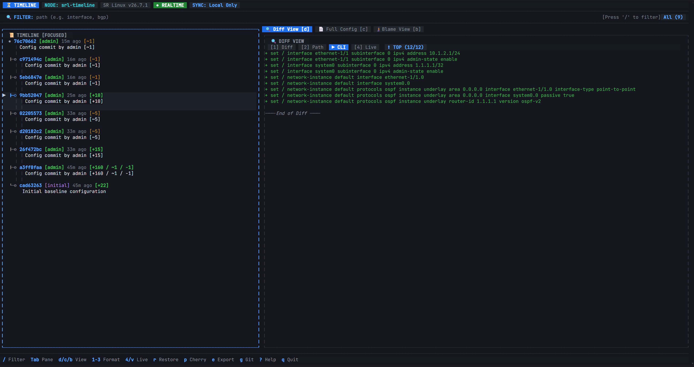

# SR Linux Timeline (`timeline`)

A configuration timeline and version history tool for Nokia SR Linux using Git.

`timeline` automatically tracks configuration changes on Nokia SR Linux switches into an on-box Git repository. It provides an interactive Terminal User Interface (TUI) launched directly from `sr_cli` (`tools timeline`) or Linux bash (`timeline`), along with command-line tools to view historical commits, inspect semantic diffs, trace line attribution, restore configurations, and synchronize with remote Git repositories.

## Features

- **Interactive Focus+Context Visual Timeline**: Horizontal timeline ribbon with a change-magnitude histogram, commit markers, and overview scrubber (`WINDOW ░▒◄═══►▒░`). Brush-select custom time windows by clicking and dragging, double-click anywhere to zoom progressively deeper into commit clusters, or jump via preset chips (`[1h]` `[24h]` `[7d]` `[All]` `[Fit]`).
- **Side-by-Side Split Diff & 2-Config Compare**: Compare any two historical revisions—or any revision against the switch's live `● RUNNING CONFIG`—in Single-Pane or Side-by-Side Split Diff (`S`) across **JSON**, **Path Changes**, and **Flat CLI** (`set` / `delete`) views, with a **Folded ↔ Full Config** (`E`) toggle and a unified 2-configuration picker (`A` / `B`).
- **Decoupled Path Filtering & Collapsible Left Panel**: Filter the timeline and commit list by subtree or keyword (`/` — e.g. `interface ethernet-1/1`, `bgp`, `acl`) while independently toggling full commit/config/blame context (`\`) with highlighted match markers (`▸`). Collapse or expand the Left Commit Panel at any time (`[◀]` / `▶` rail or `z`)—including alongside Side-by-Side Split Diff.
- **Event-Driven Instant Live Updates**: The background daemon pairs authoritative SR Linux JSON-RPC commit history over the local Unix socket (`/opt/srlinux/var/run/sr_json_rpc`) with Linux `inotify` triggers, while the TUI watches `.git/refs` directly via `inotify` so live CLI commits, rollbacks, and cherry-picks appear almost immediately.
- **Native SR Linux CLI Integration (`tools timeline`)**: Ships an `sr_cli` `ToolsPlugin` (`cli-plugins/timeline.py`) supporting tab-completed `filter`, `theme`, and `color-profile` options directly inside the SR Linux CLI.
- **Pure-Go Native Git Engine**: Writes and reads standard Git loose objects (`blob`, `tree`, `commit`) and refs directly in Go under `/etc/opt/srlinux/timeline`. Does **not** require an external `git` binary on the switch for commit recording, history, diffing, blame, restore, or export (external `git` is only optional for SSH remote push).
- **Configuration Rollback & Cherry-Pick**: Roll back the switch to any historical revision or interactively cherry-pick and restore specific configuration subtrees.
- **Configuration Blame & Analytics**: Line-by-line attribution showing who modified each line or block of configuration and when, plus per-author analytics.
- **11 Built-in Color Themes & Full-Bleed TUI**: Cycle live through 11 curated dark and light themes (<kbd>T</kbd> or <kbd>Ctrl+t</kbd> in the TUI) or select via `--theme` / `TIMELINE_THEME` and `--color-profile` / `TIMELINE_COLOR_PROFILE`.
- **Remote Git Synchronization & Export**: Push configuration history to external Git repositories (GitHub, GitLab, etc.) with optional automatic push on commit, or export any snapshot as SR Linux startup JSON (`config.json`) or flat CLI scripts.



---

## 1. Getting or Building `srl-timeline`

You can either download a pre-built Debian package / binary or build from source:

### Option A: Download Pre-built Package or Binary (Recommended)
Download the latest Debian package (`srl-timeline_0.0.5_amd64.deb`) or static Linux binary (`timeline`) from the [GitHub Releases](https://github.com/andywhitaker/srl-timeline/releases/latest) page on your local workstation.

### Option B: Build from Source with Go
`timeline` is written in pure Go and compiles to a single static binary with no external runtime dependencies:

```bash
# Clone the repository
git clone https://github.com/andywhitaker/srl-timeline.git
cd srl-timeline

# Build the Debian package (dist/srl-timeline_0.0.5_amd64.deb) and static binary (bin/timeline)
make deb

# Or compile only the static binary
CGO_ENABLED=0 go build -ldflags="-s -w" -o bin/timeline .
```

---

## 2. Install on the SR Linux Switch

### Method A: Debian Package Installation (Recommended)
The `.deb` package installs:
- `/usr/local/bin/timeline` (static binary)
- `/etc/opt/srlinux/appmgr/timeline_config.yml` (`app_mgr` daemon manifest)
- `/opt/srl-timeline/cli-plugins/timeline.py` symlinked into `/etc/opt/srlinux/cli/plugins/timeline.py` (native `tools timeline` CLI plugin)

It also configures multi-user repository permissions under `/etc/opt/srlinux/timeline`, enables the local JSON-RPC Unix domain socket (`/opt/srlinux/var/run/sr_json_rpc`), and reloads `app_mgr`:

```bash
# 1. Copy the package from your workstation to the switch
scp dist/srl-timeline_0.0.5_amd64.deb admin@<switch-ip>:/tmp/

# 2. Install on the switch (from Linux bash or via 'bash' in sr_cli)
sudo dpkg -i /tmp/srl-timeline_0.0.5_amd64.deb
```

> **Tip**: After the first install, start a new `sr_cli` session so SR Linux loads the `tools timeline` CLI plugin.

### Method B: Manual Binary & App Manager Installation
If you are installing the standalone binary manually, copy `timeline`, `timeline_config.yml`, and (optionally) `cli-plugins/timeline.py` to the switch:

#### Step 1: SCP to the switch
```bash
scp bin/timeline timeline_config.yml cli-plugins/timeline.py admin@<switch-ip>:/tmp/
```

#### Step 2: Log into the switch, install, and bootstrap `timeline`

- **From the SR Linux CLI**:
  ```text
  --{ running }--[  ]--
  A:srl-timeline# bash sudo mv /tmp/timeline /usr/local/bin/timeline
  A:srl-timeline# bash sudo chmod +x /usr/local/bin/timeline
  A:srl-timeline# bash sudo mv /tmp/timeline_config.yml /etc/opt/srlinux/appmgr/timeline_config.yml
  A:srl-timeline# bash sudo mkdir -p /etc/opt/srlinux/cli/plugins
  A:srl-timeline# bash sudo mv /tmp/timeline.py /etc/opt/srlinux/cli/plugins/timeline.py
  A:srl-timeline# bash sudo timeline daemon bootstrap
  ```

- **From the Linux Bash Shell**:
  ```bash
  sudo mv /tmp/timeline /usr/local/bin/timeline
  sudo chmod +x /usr/local/bin/timeline
  sudo mv /tmp/timeline_config.yml /etc/opt/srlinux/appmgr/timeline_config.yml
  sudo mkdir -p /etc/opt/srlinux/cli/plugins
  sudo mv /tmp/timeline.py /etc/opt/srlinux/cli/plugins/timeline.py
  sudo timeline daemon bootstrap
  ```

---

## 3. Run Timeline

The primary way to interact with `timeline` is through the visual **Terminal User Interface (TUI)**:

- **From the SR Linux CLI** (supports tab-completion for `theme` and `color-profile`):
  ```text
  --{ running }--[  ]--
  A:srl-timeline# tools timeline
  A:srl-timeline# tools timeline filter bgp theme nord
  A:srl-timeline# tools timeline filter "interface ethernet-1/1" theme cobalt2 color-profile truecolor
  ```
  *(You can also launch via `bash timeline`.)*

- **From the Linux Bash Shell**:
  ```bash
  timeline
  timeline --filter "interface ethernet-1/1" --theme dracula
  ```

---

## How It Works

1. **Background Recorder (`app_mgr`)**: `timeline daemon start` runs under SR Linux `app_mgr` (`timeline_config.yml`) and stores normalized snapshots (`config.json` and `config.cli`) in a pure-Go Git repository at `/etc/opt/srlinux/timeline`.
2. **Authoritative Commit Metadata + `inotify` Fast-Path**: The daemon queries SR Linux's structured `/system/configuration/commit` state over the local JSON-RPC Unix domain socket (`/opt/srlinux/var/run/sr_json_rpc`, requiring no credentials) and pairs it with a Linux kernel `inotify` trigger on `/var/log/srlinux/file/messages` so commits are captured in milliseconds without brittle log parsing.
3. **Instant TUI Refresh**: The interactive TUI watches `.git/refs/heads` and `.git/HEAD` via Linux `inotify` (with a background fallback ticker), automatically refreshing the commit list, expanding custom timeline windows when new live commits arrive, and keeping restores and cherry-picks immediately visible.

---

## Color Themes & Terminal Appearance

`timeline` includes **11 built-in color themes** (9 dark themes and 2 light themes) with full-bleed surface rendering that adapts cleanly to both dark and light terminal emulators:

| Theme Name (`--theme`) | Display Name | Mode |
|---|---|---|
| `dark` *(default)* | GitHub Dark | Dark |
| `cobalt2` | Cobalt2 | Dark |
| `monokai` | Monokai | Dark |
| `solarized-dark` | Solarized Dark | Dark |
| `dracula` | Dracula | Dark |
| `nord` | Nord | Dark |
| `catppuccin-mocha` | Catppuccin Mocha | Dark |
| `tokyo-night` | Tokyo Night | Dark |
| `gruvbox-dark` | Gruvbox Dark | Dark |
| `light` | GitHub Light | Light |
| `solarized-light` | Solarized Light | Light |

- **Cycle live or pick in the TUI**: Press <kbd>T</kbd> (`Shift+t`) to cycle through all 11 themes immediately, or <kbd>Ctrl+t</kbd> to open the Theme Picker modal.
- **List available themes**:
  ```bash
  timeline themes
  ```
- **Select via CLI flag or environment variable**:
  ```bash
  timeline --theme nord
  TIMELINE_THEME=solarized-light timeline
  ```
- **Terminal color profile override**: Control ANSI color depth via `--color-profile <truecolor|256|ansi|ascii>` or `TIMELINE_COLOR_PROFILE` (also respects `NO_COLOR`):
  ```bash
  timeline --color-profile 256 --theme gruvbox-dark
  ```

---

## Direct Download One-Liner (Optional)

If your SR Linux switch has direct outbound internet access, you can download and install the binary, `app_mgr` config, and CLI plugin directly on the switch:

```bash
sudo curl -sL https://github.com/andywhitaker/srl-timeline/releases/latest/download/timeline -o /usr/local/bin/timeline && \
sudo chmod +x /usr/local/bin/timeline && \
sudo curl -sL https://raw.githubusercontent.com/andywhitaker/srl-timeline/main/timeline_config.yml -o /etc/opt/srlinux/appmgr/timeline_config.yml && \
sudo mkdir -p /etc/opt/srlinux/cli/plugins && \
sudo curl -sL https://raw.githubusercontent.com/andywhitaker/srl-timeline/main/cli-plugins/timeline.py -o /etc/opt/srlinux/cli/plugins/timeline.py && \
sudo timeline daemon bootstrap
```

---

## Lab Deployment (Containerlab)

If you are running in a Containerlab test environment rather than a physical switch, you can deploy the included test lab directly:

```bash
sudo clab deploy -t timeline.clab.yml
```

Because `timeline` includes a pure-Go native Git object engine, minimal SR Linux containers do **not** require `git` or host bind-mounts of `/usr/bin/git` and `/usr/lib/git-core` for commit recording, history browsing, diffing, blame, restore, or export:

```yaml
topology:
  nodes:
    srl-timeline:
      kind: nokia_srlinux
      image: ghcr.io/nokia/srlinux:latest
      type: ixr-d2l
      binds:
        - bin/timeline:/usr/local/bin/timeline
        - timeline_config.yml:/etc/opt/srlinux/appmgr/timeline_config.yml
        - cli-plugins/timeline.py:/etc/opt/srlinux/cli/plugins/timeline.py
```

> **Note**: An external `git` binary is only needed if you use `timeline remote push` (or auto-push) to synchronize commits to a remote SSH Git server.

---

## TUI Keyboard Shortcuts

| Shortcut | Action |
|---|---|
| <kbd>j</kbd> / <kbd>↓</kbd> | Next commit in timeline (or scroll down in Detail pane) |
| <kbd>k</kbd> / <kbd>↑</kbd> | Previous commit in timeline (or scroll up in Detail pane) |
| <kbd>PgUp</kbd> / <kbd>PgDn</kbd>, <kbd>Home</kbd> / <kbd>End</kbd> | Page scroll or jump to top / bottom of active pane |
| <kbd>Tab</kbd> / <kbd>Shift+Tab</kbd> | Cycle focus across Timeline, Detail, and Visual Timeline Ribbon |
| <kbd>←</kbd> / <kbd>→</kbd> | Focus Timeline/Detail pane (or step commits chronologically when Ribbon is focused) |
| <kbd>d</kbd> / <kbd>c</kbd> / <kbd>b</kbd> / <kbd>t</kbd> | Switch Detail view (**Diff**, **Config**, **Blame**, or cycle next tab) |
| <kbd>1</kbd> / <kbd>2</kbd> / <kbd>3</kbd> | Select sub-formats (**JSON**, **Path Changes**, **Flat CLI** in Diff; **CLI**, **JSON** in Config; **Attribution**, **Analytics** in Blame) |
| <kbd>S</kbd> | Toggle **Single-Pane ↔ Side-by-Side Split Diff** (older `A` on left, newer `B` on right; requires ≥100 cols) |
| <kbd>E</kbd> | Toggle **Folded** unchanged context ↔ **Full Config** (in Side-by-Side Split Diff) |
| <kbd>A</kbd> / <kbd>B</kbd> | Open **Compare 2 Configurations** picker (`Space` toggles up to 2, `c` clears, `Enter` auto-assigns older→`A`, newer/`● RUNNING`→`B`) |
| <kbd>m</kbd> | Pin / unpin compare anchor commit (`BASE`) |
| <kbd>4</kbd> or <kbd>v</kbd> | Toggle **Live Compare Mode** (Revision vs `● RUNNING CONFIG`) |
| <kbd>w</kbd> | Collapse / expand **Visual Timeline Ribbon** (toggles line wrap when focused in Blame view) |
| <kbd>[</kbd> / <kbd>{</kbd> | Move timeline window **start** edge inward / outward |
| <kbd>]</kbd> / <kbd>}</kbd> | Move timeline window **end** edge inward / outward |
| <kbd>&lt;</kbd> / <kbd>&gt;</kbd> | Pan timeline window earlier / later |
| <kbd>+</kbd> / <kbd>-</kbd> | Zoom timeline window in / out around selected commit |
| <kbd>f</kbd> / <kbd>0</kbd> | Fit window to matching commits / Reset window to **All** history |
| <kbd>z</kbd> | Collapse / expand Left Panel (full-width Detail **Zoom**) |
| <kbd>/</kbd> | Focus search / path filter bar |
| <kbd>\\</kbd> | Toggle **Full Commit / Re-scope Detail** while keeping Timeline filtered (highlights matches with cyan `▸`) |
| <kbd>Esc</kbd> | Unzoom / return focus / clear filter / close modal |
| <kbd>r</kbd> | Open **Restore Modal** (Full configuration rollback) |
| <kbd>p</kbd> | Open **Cherry-Pick Modal** (Interactive subtree restore) |
| <kbd>e</kbd> | Open **Export Modal** (Save to file or startup config) |
| <kbd>g</kbd> | Open **Remote Git Settings Modal** |
| <kbd>R</kbd> / <kbd>F5</kbd> | Reload / refresh timeline from disk |
| <kbd>T</kbd> / <kbd>Ctrl+t</kbd> | Cycle **Color Theme** live / Open Theme Picker Modal |
| <kbd>?</kbd> | Display Help dialog |
| <kbd>q</kbd> | Quit application |

## TUI Mouse Controls

| Gesture | Action |
|---|---|
| **Click & drag across Timeline Ribbon** | Brush-select a custom time window directly on the timeline |
| **Double-click Timeline Ribbon** | Progressively zoom deeper into the commits clustered around that point |
| **Drag `◄` / `►` handles or scrubber bar** | Resize or pan the active time window along the overview scrubber |
| **Scroll wheel over Timeline Ribbon** | Zoom the active time window in or out |
| **Click preset chips** | Jump instantly to `[1h]`, `[24h]`, `[7d]`, `[All]`, or `[Fit]` |
| **`Ctrl+Click` / `Shift+Click` / `Alt+Click` / `Right-Click` a 2nd commit** | Open Side-by-Side Split Diff comparing that commit with the currently selected commit (older→`A`, newer→`B`) |
| **Click any commit** | Select that commit (and return to Single Commit view if currently in Split Diff) |
| **Click `[◀]` or collapsed `▶` rail** | Collapse or expand the Left Commit Panel independently in any view |
| **Click `[A ▾]` / `[B ▾]` split headers** | Open the unified **Compare 2 Configurations** picker |
| **Click FilterBar / Detail scope pill** | Toggle between filtered subset and full commit/config/blame view (`\`) |
| **Click or drag any vertical scrollbar** | Jump to position or continuously scrub through Diff, Config, Blame, or Commit List |

---

## Command-Line Interface (CLI Commands)

In addition to the interactive TUI, `timeline` provides subcommands for automation, scripting, CI/CD pipelines, or quick queries from the shell:

```bash
# List all built-in color themes
timeline themes

# View commit history
timeline log --limit 20
timeline log --filter bgp --theme cobalt2

# Semantic diff between revisions (formats: unified, json, cli, path)
timeline diff HEAD~1 HEAD
timeline diff HEAD~2 HEAD --format cli
timeline diff <sha1> <sha2> --format path --filter ethernet-1/1

# Show configuration at a point in time (or live running config)
timeline show HEAD --format cli
timeline show running --format json --filter system

# Line-by-line blame attribution
timeline blame --filter ethernet-1/1

# Full configuration restore
timeline restore <sha> --yes

# Cherry-pick restore specific paths (via 'cherry-pick' or 'restore --path')
timeline cherry-pick <sha> --path "/interface[name=ethernet-1/1]/description" --yes
timeline restore <sha> --path "/interface[name=ethernet-1/1]/description"

# Export configuration
timeline export <sha> --format json --output /tmp/snapshot.json
timeline export <sha> --save-startup

# Remote Git synchronization
timeline remote show
timeline remote key
timeline remote set git@github.com:org/srl-configs.git --auto-push
timeline remote push

# Background recorder daemon management
timeline daemon status
timeline daemon bootstrap
timeline daemon start
timeline daemon stop
```

---

## License

Apache License 2.0
